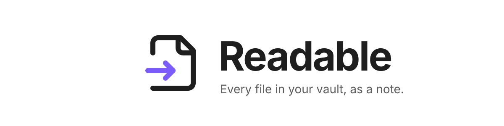
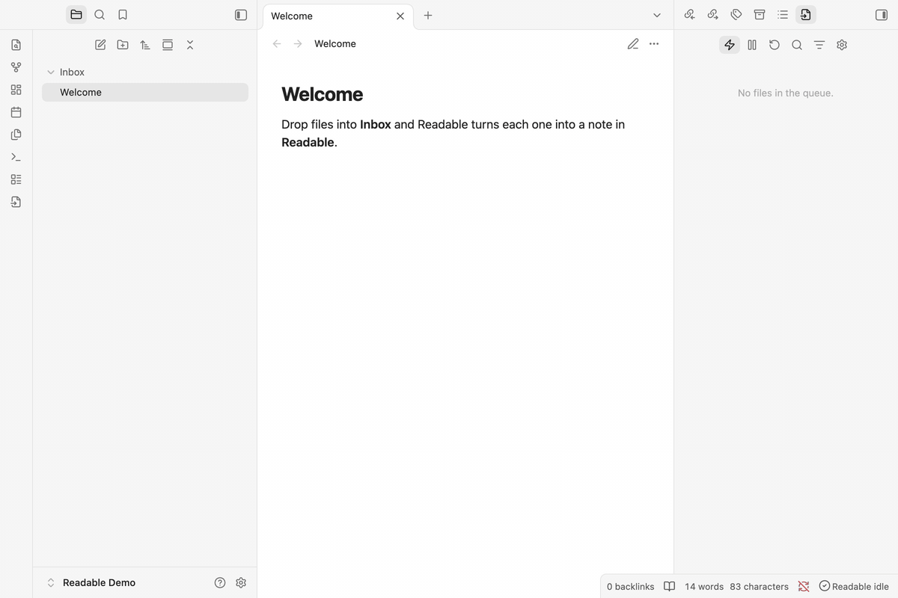
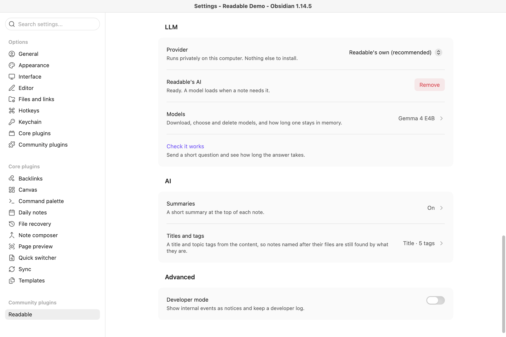
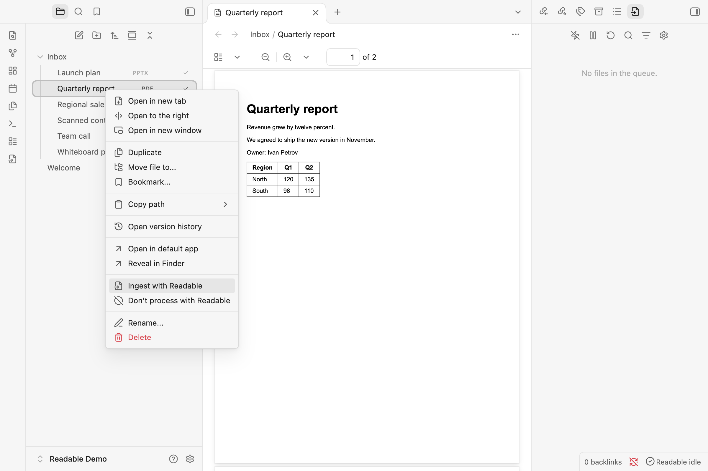
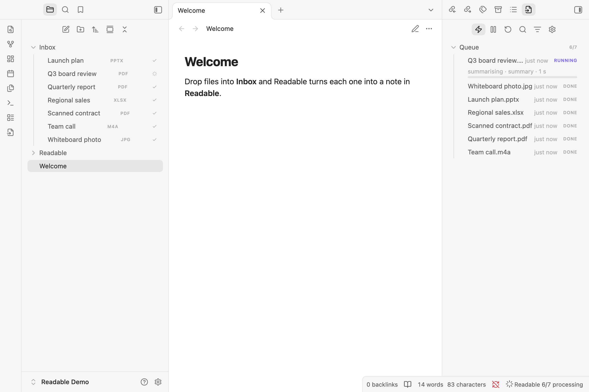
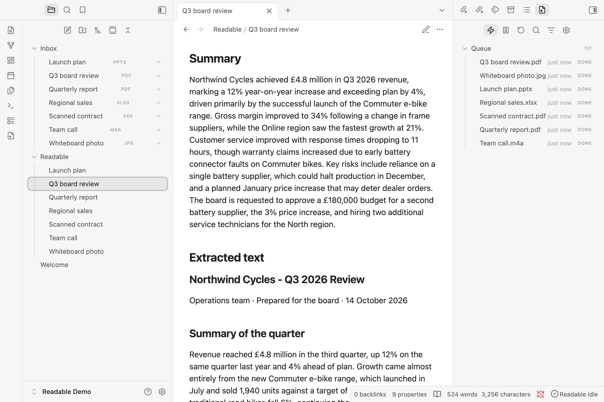
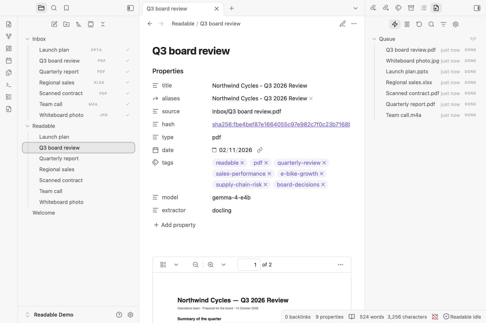

<p align="center">
  <picture>
    <source media="(prefers-color-scheme: dark)" srcset="https://raw.githubusercontent.com/lyra-gen/readable/main/assets/banner-dark.svg">
    
  </picture>
</p>

<p align="center">
  Turn PDFs, scans, recordings and Office files into notes. Everything runs on your computer.
</p>

<p align="center">
  <a href="#install">Install</a> ·
  <a href="#quick-start">Quick start</a> ·
  <a href="#your-files-stay-on-your-computer">Privacy</a> ·
  <a href="https://github.com/lyra-gen/readable/releases">Changelog</a> ·
  <a href="https://lyragen.co.uk/">LyraGen</a>
</p>

<p align="center">
  
  
  
</p>

<p align="center">
  <picture>
    <source media="(prefers-color-scheme: dark)" srcset="https://raw.githubusercontent.com/lyra-gen/readable/main/assets/readme/readable-dark.gif">
    
  </picture>
</p>

Drop a file into your vault and Readable writes a note for it: title, tags and summary from a local model, the file embedded, and its full text with tables and figures. Plain Markdown, so Obsidian search, Omnisearch and your AI tools can find what was in the file.

| | |
|---|---|
| **Documents** | PDF, Word, PowerPoint, Excel, OpenDocument, iWork, HTML, CSV |
| **Scans and pictures** | PNG, JPEG, HEIC, WebP, TIFF, scanned PDFs: OCR or a vision model |
| **Recordings** | MP3, M4A, WAV, MP4, MOV and more: Whisper transcripts |

## Install

Desktop only. In Obsidian, open **Settings → Community plugins → Browse**, search for **Readable** and install it, or open its [directory page](https://community.obsidian.md/plugins/readable) and choose **Add to Obsidian**. You can also copy `main.js`, `manifest.json` and `styles.css` from the [latest release](https://github.com/lyra-gen/readable/releases) into `.obsidian/plugins/readable/`.

## Quick start

**1. Install the engines.** Enable Readable and press **Install** when it asks for Docling, which reads documents (about 2 GB). Then open **Settings → Readable → LLM**, keep **Readable's own** as the provider, install it and download the recommended model under **Models** (Gemma 4 E4B, about 5 GB, best with 16 GB of memory). Already run Ollama or LM Studio? Pick it as the provider instead.

<p align="center">
  <picture>
    <source media="(prefers-color-scheme: dark)" srcset="https://raw.githubusercontent.com/lyra-gen/readable/main/assets/readme/quickstart/dark/1-local-ai.png">
    
  </picture>
</p>

**2. Ingest a file.** Right-click a file or folder → **Ingest with Readable**. To skip the right-click, turn on **Auto-ingest new files** under **Automation** and pick a watched folder.

<p align="center">
  <picture>
    <source media="(prefers-color-scheme: dark)" srcset="https://raw.githubusercontent.com/lyra-gen/readable/main/assets/readme/quickstart/dark/2-ingest-menu.png">
    
  </picture>
</p>

**3. Watch the queue.** The queue on the right shows each file as it is read and summarised. Files that are done get a tick in the file list.

<p align="center">
  <picture>
    <source media="(prefers-color-scheme: dark)" srcset="https://raw.githubusercontent.com/lyra-gen/readable/main/assets/readme/quickstart/dark/3-queue.png">
    
  </picture>
</p>

**4. Read the note.** Each file gets a note in the **Readable** folder: a summary, then the full text with its tables.

<p align="center">
  <picture>
    <source media="(prefers-color-scheme: dark)" srcset="https://raw.githubusercontent.com/lyra-gen/readable/main/assets/readme/quickstart/dark/4-summary.png">
    
  </picture>
</p>

The note's title and tags come from what the file says, so search finds `Q3 board review.pdf` by "supply chain risk" as well as by its name.

<p align="center">
  <picture>
    <source media="(prefers-color-scheme: dark)" srcset="https://raw.githubusercontent.com/lyra-gen/readable/main/assets/readme/quickstart/dark/5-title-and-tags.png">
    
  </picture>
</p>

## Your files stay on your computer

Docling and the model server run on this machine, and text goes only to the model server address you set. Readable has no telemetry, no account and no paid tier. Links and HTML inside documents are written as text, never embedded.

### Network use

Readable downloads its engines and models only when you press **Install** or **Download** in its settings, at pinned versions:

| Host | What | When |
|---|---|---|
| `github.com` | uv, the Python it installs, and the llama.cpp model server | Installing Docling, or Readable's own AI |
| `pypi.org`, `files.pythonhosted.org` | Docling and its Python packages; ffmpeg for the speech add-on | Installing Docling or an add-on |
| `huggingface.co` | Docling's layout and table models, the Whisper speech model, and the chat models on the Models page | Installing Docling or the speech add-on, or downloading a model |
| `www.modelscope.cn` | RapidOCR's text recognition models | Installing the RapidOCR add-on only |
| The address under **LLM** | The text of each file, for its summary, title and tags | Each ingest, when AI features are on |

With **Readable's own** AI that last address is a server on this computer that only this computer can reach. If you point it at Ollama, LM Studio or another server, text goes wherever that server runs. Nothing else is contacted.

### Files outside the vault

Readable keeps its engines, models and each vault's queue in its own app-data folder, never in the vault: `~/Library/Application Support/Readable` on macOS, `%APPDATA%\Readable` on Windows, `~/.local/share/readable` on Linux. Docling with its models takes about 2 GB, the speech add-on about 2 GB more, and each chat model 2 to 6 GB. **Remove** and **Delete** in settings delete them. If you set an extra models folder, Readable reads `.gguf` files from it and never writes there.

### Programs it runs

Readable starts programs from that folder, with fixed arguments and never through a shell: a Python process that runs Docling and Whisper, ffmpeg for recordings, and the llama.cpp server for Readable's own AI. Each stops when it is not needed or when Obsidian closes.

## Development

```sh
npm install
npm run dev     # watch build
npm test
```

Architecture and conventions: [ARCHITECTURE.md](ARCHITECTURE.md).

Readable installs Docling, uv, Python, llama.cpp, Whisper and ffmpeg on request, each under its own licence; it does not bundle them. Each model's licence is on its Hugging Face page. Bundled npm packages: [THIRD_PARTY_NOTICES.md](THIRD_PARTY_NOTICES.md).

[MIT](LICENSE) · Made by [LyraGen](https://lyragen.co.uk/)
